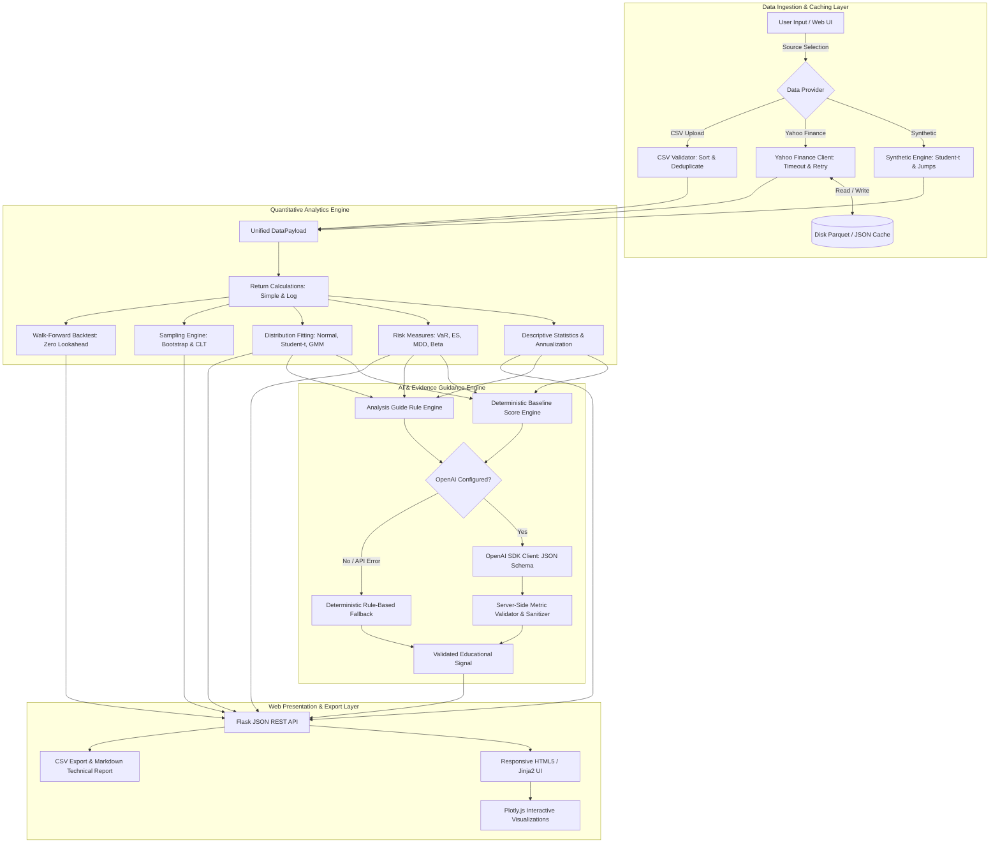

# System Architecture: Stock Market Distribution Analyzer

The **Stock Market Distribution Analyzer** is engineered with a strict modular architecture separating data ingestion, statistical calculation, AI orchestration, and user presentation. This design ensures that all calculations are unit-testable, headless, and verifiable without running a browser or external network connection.

---

## 1. Architectural Data Flow

---

## 2. Module Responsibilities

### `data/` Layer
- **`loader.py`**: Unified interface that coordinates data acquisition and returns a standardized `DataPayload` object with aligned stock and benchmark series.
- **`synthetic.py`**: Generates synthetic geometric Brownian motion with Student-t ($\nu=5$) innovations, negative crash skewness, and market holidays. Always flags output as synthetic.
- **`yfinance_provider.py`**: Interacts with Yahoo Finance for Indian symbols (`.NS`, `.BO`). Enforces request timeouts (10 seconds), automatic retries, and normalizes ticker symbols.
- **`csv_provider.py`**: Parses single-series and multi-series CSV files. Normalizes headers, parses varied date formats, sorts chronologically, removes duplicates, validates positive prices, and enforces a 15-observation minimum.
- **`cache.py`**: Thread-safe disk cache storing downloaded time-series in Parquet format accompanied by JSON metadata (fetch timestamp, row count, expiration).

### `analytics/` Layer
- **`returns.py`**: Computes simple percentage returns, continuously compounded log returns, cumulative return trajectories, and base-100 indexed price series.
- **`statistics.py`**: Computes sample moments (mean, variance, standard deviation, Fisher-Pearson skewness, excess kurtosis), percentiles (1st to 99th), CAGR, and documents the Indian 252-day annualization convention.
- **`risk.py`**: Computes Historical VaR, Parametric VaR, Expected Shortfall (CVaR), Maximum Drawdown with peak/trough dates, rolling 21-day volatility, CAPM Beta, Correlation, Sharpe ratio, and Sortino ratio.
- **`distributions.py`**: Fits Normal and Student-t distributions via Maximum Likelihood Estimation (MLE), computes AIC, BIC, Kolmogorov-Smirnov test statistics, Jarque-Bera test statistics, fits a 2-component Gaussian Mixture Model (GMM), and generates theoretical vs. empirical Q-Q coordinates.
- **`sampling.py`**: Executes IID and Moving-Block bootstrap resamplings (1,000 iterations) with fixed random seeds for reproducibility. Runs the Central Limit Theorem explorer across sample sizes $n \in \{5, 10, 30, 50\}$.
- **`backtest.py`**: Runs a chronological dual moving-average walk-forward simulation. Guarantees zero lookahead bias by computing signals at day $t$ and entering trades at day $t+1$, subtracting 10 bps transaction fees.

### `ai/` Layer
- **`schemas.py`**: Pydantic models enforcing strict JSON structures and allowed enum values (`BUY`, `HOLD`, `SELL`; `HIGH`, `MEDIUM`, `LOW`, `INSUFFICIENT_EVIDENCE`).
- **`validator.py`**: Validates candidate LLM outputs against server-side ground truth metrics. Downgrades signals to `HOLD / INSUFFICIENT_EVIDENCE` if sample size is under 60 days, and sanitizes unsupported price targets or promotional phrasing.
- **`signal_generator.py`**: Calculates an objective deterministic baseline score (-1.0 to +1.0) and constructs structured prompts containing verified server-side statistics.
- **`analysis_guide.py`**: Scans empirical statistics for anomalies (leptokurtosis, negative skewness, volatility spikes) and generates targeted next-step recommendations citing exact trigger numbers.
- **`service.py`**: Server-side client utilizing the official OpenAI Python SDK. Handles API errors gracefully and falls back to deterministic rule scoring without interrupting the user experience.

### `reports/` Layer
- **`export.py`**: Generates clean CSV exports of processed series (prices, returns, drawdowns, rolling vol) and formatted Markdown analysis reports for academic coursework or laboratory submission.

### Web & Presentation Layer
- **`app.py`**: Flask application defining routes (`/`, `/api/analyze`, `/api/export/csv`, `/api/export/report`, `/api/sample-csv/<filename>`, `/health`).
- **`templates/`**: Responsive Jinja2 HTML templates (`base.html`, `index.html`) featuring accessible typography, semantic color codes, and educational modals.
- **`static/`**: Custom CSS (`styles.css`), client-side application logic (`app.js`), and a locally bundled copy of `plotly.min.js` ensuring 100% offline functionality.

---

## 3. Security & Operational Isolation

1. **Zero Secret Exposure:** All OpenAI API keys are loaded server-side from `.env` via `python-dotenv`. Keys are never passed to browser JavaScript, template context, logs, or exports.
2. **Offline Resilience:** The application, help modals, sample CSVs, and Plotly charting library function completely disconnected from the internet.
3. **No Database Requirements:** Uses lightweight file-based caching (`.cache/`) and in-memory execution, requiring zero complex database setup.
