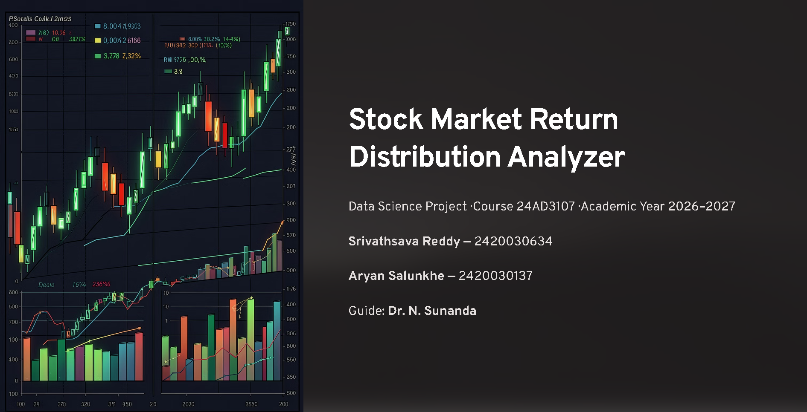
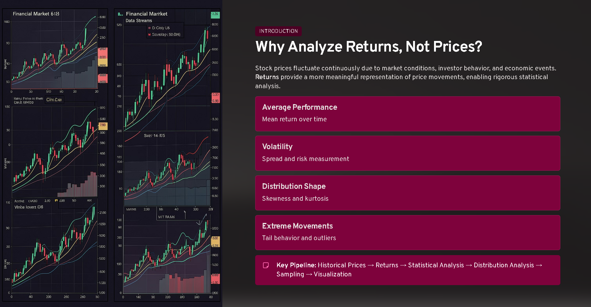
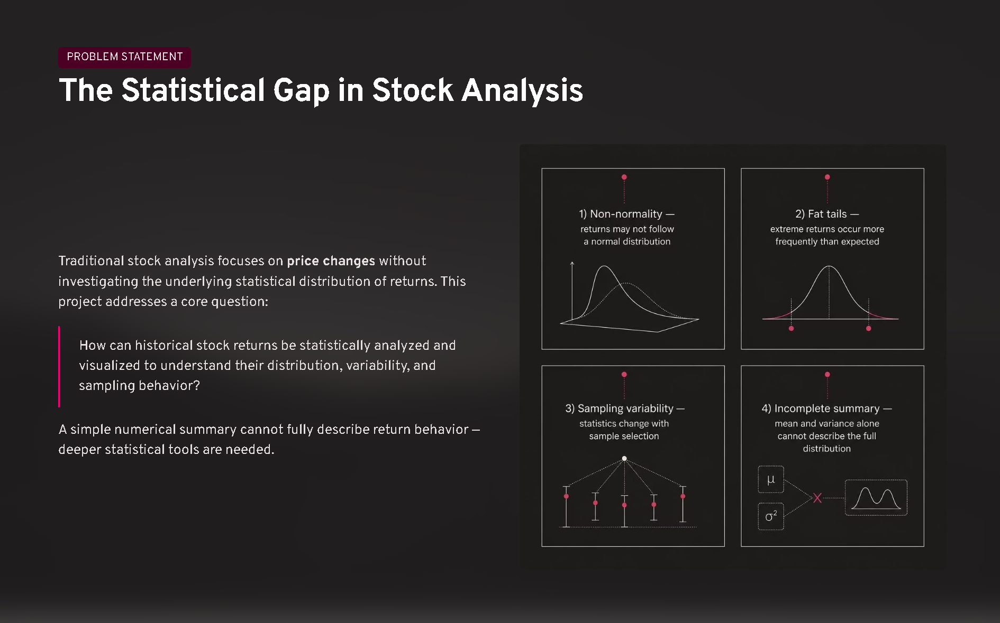
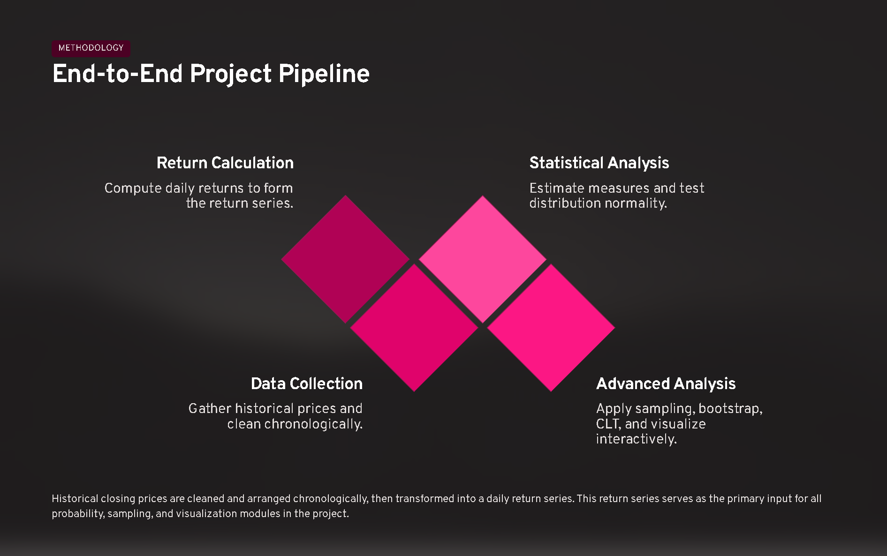
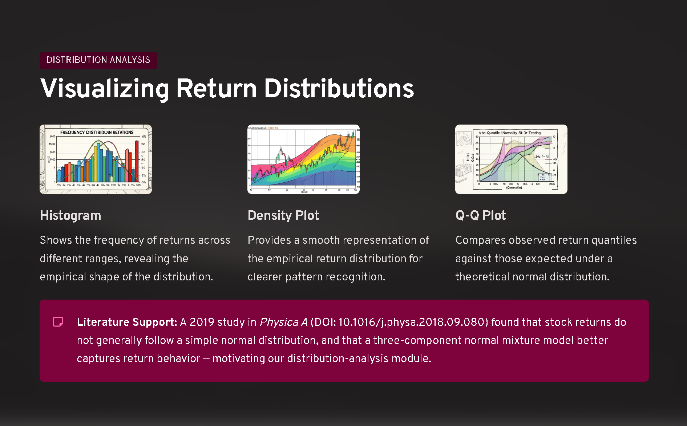
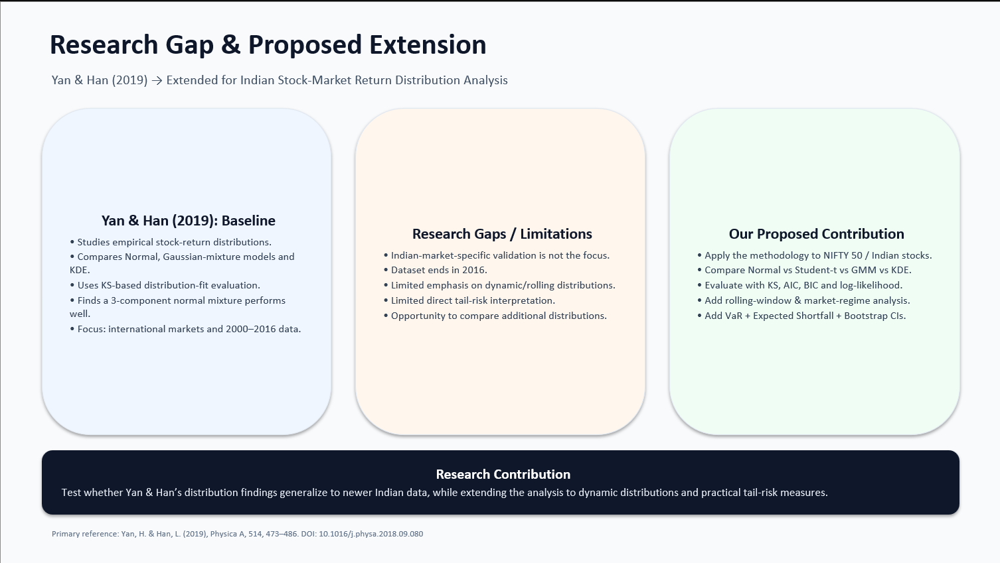
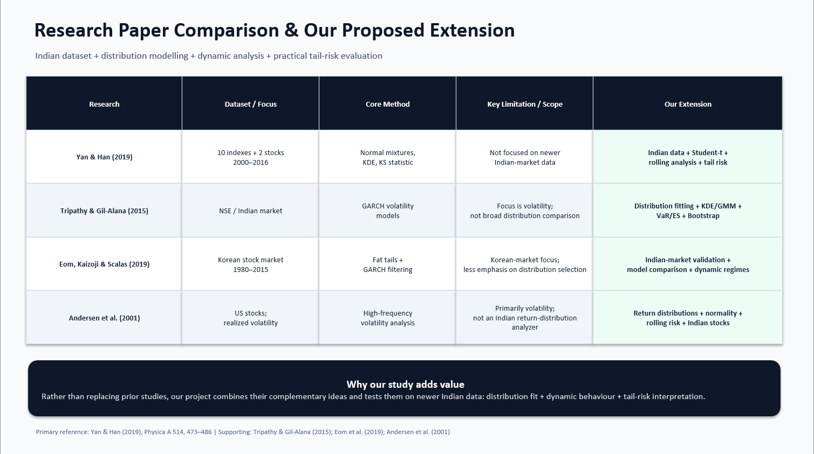
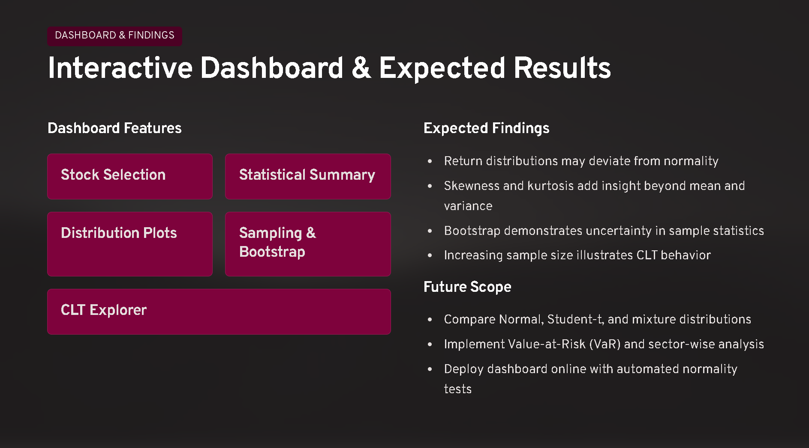

# Stock Market Return Distribution Analyzer: 10-Slide Project Presentation Deck

> **Course Code:** 24AD3107 (Data Science Project)  
> **Academic Year:** 2026–2027  
> **Institution:** Department of Computer Science and Engineering, KLH University, Hyderabad  
> **Team Members:**  
> - **A. Srivathsava Reddy** (Registration No: **2420030634**)  
> - **Aryan Vinayak Salunkhe** (Registration No: **2420030137**)  
> **Project Guide:** **Dr. N. Sunanda** (Associate Professor, Department of CSE)  
> **Source Presentation File:** [`presentation/pptx/Stock_Market_Return_Distribution_Analyzer_10_Slides.pptx`](pptx/Stock_Market_Return_Distribution_Analyzer_10_Slides.pptx)

---

## Slide 1: Title Slide



### Content
* **Project Title:** **Stock Market Return Distribution Analyzer**
* **Project Category:** Data Science Project
* **Course Code:** **24AD3107**
* **Academic Year:** **2026–2027**
* **Team Members:**
  * **Srivathsava Reddy** — Registration No: **2420030634**
  * **Aryan Salunkhe** — Registration No: **2420030137**
* **Project Guide:** **Dr. N. Sunanda** (Associate Professor, CSE)
* **Visual Elements:** Dark-themed financial candlestick trading chart displaying volume profiles, price channels, moving averages, and market indicators.

---

## Slide 2: Introduction — Why Analyze Returns, Not Prices?



### Key Concept
Stock prices fluctuate continuously due to market conditions, investor behavior, and economic events. **Returns provide a more meaningful representation of price movements**, enabling rigorous statistical and econometric analysis by stabilizing non-stationary price series.

### Core Analytical Dimensions
1. **Average Performance:** Mean return over time across daily trading sessions.
2. **Volatility:** Spread, dispersion, and risk measurement ($\sigma_{\text{ann}} = \sigma_{\text{daily}} \times \sqrt{252}$).
3. **Distribution Shape:** Higher moments: Skewness (asymmetry) and Kurtosis (fat-tail peakedness).
4. **Extreme Movements:** Tail behavior, catastrophic market crashes, and outlier dynamics.

> **Key Pipeline:**  
> $\text{Historical Prices} \longrightarrow \text{Returns} \longrightarrow \text{Statistical Analysis} \longrightarrow \text{Distribution Analysis} \longrightarrow \text{Sampling} \longrightarrow \text{Visualization}$

---

## Slide 3: Problem Statement — The Statistical Gap in Stock Analysis



### Core Question
> *"How can historical stock returns be statistically analyzed and visualized to understand their distribution, variability, and sampling behavior?"*

Traditional stock analysis focuses purely on price changes without investigating the underlying statistical distribution of returns. A simple numerical summary cannot fully describe return behavior — deeper statistical tools are required.

### Four Critical Statistical Gaps
1. **Non-normality:** Returns do not follow a Gaussian bell curve; empirical distributions are sharply peaked.
2. **Fat Tails:** Extreme returns (3-sigma, 5-sigma events) occur much more frequently than classical models predict.
3. **Sampling Variability:** Statistics change with sample selection and historical regimes.
4. **Incomplete Summary:** Mean and variance alone cannot describe multimodal or heavy-tailed empirical distributions.

---

## Slide 4: Objectives — What This Project Sets Out to Do


1. **Collect & Clean Data:** Obtain historical stock prices from reliable sources and handle missing or invalid observations.
2. **Calculate Returns:** Compute daily return series from consecutive closing prices ($R_t = \frac{P_t - P_{t-1}}{P_{t-1}}$).
3. **Statistical Measures:** Compute mean, variance, standard deviation, skewness, and kurtosis.
4. **Distribution & Normality:** Visualize return distributions and rigorously test the normality assumption.
5. **Sampling & Bootstrap:** Perform sampling experiments and bootstrap resampling for uncertainty estimation.
6. **CLT & Dashboard:** Demonstrate the Central Limit Theorem and build an interactive web dashboard.

---

## Slide 5: Methodology — End-to-End Project Pipeline



```text
[ Data Collection ]
Gather historical prices and clean chronologically
       │
       ▼
[ Return Calculation ]
Compute daily returns to form the return series
       │
       ▼
[ Statistical Analysis ]
Estimate measures and test distribution normality
       │
       ▼
[ Advanced Analysis ]
Apply sampling, bootstrap, CLT, and visualize interactively
```

> **Pipeline Invariant:** Historical closing prices are cleaned and arranged chronologically, then transformed into a daily return series. This return series serves as the primary input for all probability, sampling, and visualization modules in the project.

---

## Slide 6: Return Calculation — Computing Daily Stock Returns


### Mathematical Formulation
For consecutive closing prices $P_t$ and $P_{t-1}$, the simple daily return $R_t$ is defined as:

$$R_t = \frac{P_t - P_{t-1}}{P_{t-1}}$$

* **$P_t$:** Current session closing price.
* **$P_{t-1}$:** Previous session closing price.
* **$R_t$:** One-day rate of return.

### Worked Example
$$\text{If } P_{t-1} = 100 \text{ and } P_t = 105, \text{ then:}$$
$$R_t = \frac{105 - 100}{100} = \frac{5}{100} = 0.05 \implies \mathbf{+5.0\%\text{ daily return}}$$

---

## Slide 7: Distribution Analysis — Visualizing Return Distributions



### Three Visual Diagnostics
1. **Histogram:** Shows the frequency of returns across different bins, revealing the empirical shape of the distribution.
2. **Density Plot:** Provides a smooth kernel density representation of the empirical return distribution for clearer pattern recognition.
3. **Q-Q Plot:** Compares observed return quantiles against those expected under a theoretical normal distribution, exposing tail divergence.

### Literature Support
> **Physica A (2019) Benchmark:** A study by Yan & Han (2019) published in *Physica A: Statistical Mechanics and its Applications* (DOI: [10.1016/j.physa.2018.09.080](https://doi.org/10.1016/j.physa.2018.09.080)) established that stock returns do not generally follow a simple normal distribution, and that multi-component mixture models and heavy-tailed distributions better capture return behavior — motivating our distribution-analysis module.

---

## Slide 8: Research Gap & Proposed Extension



### Comparative Breakdown: Yan & Han (2019) vs. Our Work

| Dimension | Yan & Han (2019): Baseline | Research Gaps / Limitations | Our Proposed Contribution |
| :--- | :--- | :--- | :--- |
| **Market Scope** | 10 international indexes + 2 US stocks | Indian-market-specific validation is not the focus | Apply methodology to NIFTY 50 and Indian blue-chip stocks (Reliance, TCS, INFY) |
| **Time Horizon** | 2000–2016 historical window | Dataset ends in 2016; misses recent market regimes | Extended horizon: **2000–2026 YTD** (incorporating COVID-19 and post-pandemic cycles) |
| **Distribution Models** | Normal, Gaussian Mixtures, KDE | Limited comparison of alternative fat-tail distributions | Rigorous comparison: **Normal vs. Student-$t$ vs. 2-GMM vs. KDE** evaluated via AIC, BIC, and KS tests |
| **Risk Interpretation** | Theoretical statistical fit | Limited direct tail-risk and practical investment metrics | Integration of **Value at Risk (VaR)**, **Expected Shortfall (ES / CVaR)**, and **Underwater Drawdowns** |
| **Sampling & Validation** | Static cross-sectional analysis | Limited dynamic time-series and sampling variability | Dynamic rolling analysis, **IID & Moving-Block Bootstrap**, and **CLT simulation** |

> **Core Research Contribution:** Test whether Yan & Han's distribution findings generalize to newer Indian data (2000–2026 YTD), while extending the analysis to dynamic distributions and practical tail-risk measures.

---

## Slide 9: Research Paper Comparison & Our Proposed Extension



### Comparative Literature Matrix

| Research Paper | Dataset / Focus | Core Method | Key Limitation / Scope | Our Extension |
| :--- | :--- | :--- | :--- | :--- |
| **Yan & Han (2019)**<br>*Physica A* | 10 international indexes + 2 stocks (2000–2016) | Normal mixtures, KDE, Kolmogorov-Smirnov test | Not focused on newer Indian-market data | Indian data + Student-$t$ MLE + rolling analysis + practical tail-risk measures |
| **Tripathy & Gil-Alana (2015)**<br>*Indian Stock Market* | NSE / Indian market equities | GARCH volatility modeling | Focus is solely volatility dynamics; not broad distribution comparison | Distribution fitting + GMM/KDE + VaR / Expected Shortfall + Bootstrap CIs |
| **Eom, Kaizoji & Scalas (2019)**<br>*Financial Time Series* | Korean stock market (1980–2015) | Fat tails + GARCH filtering | Korean-market focus; less emphasis on distribution model selection | Indian-market validation + model selection criteria (AIC/BIC) + dynamic regimes |
| **Andersen et al. (2001)**<br>*Econometrica* | US stocks; realized volatility | High-frequency intraday volatility analysis | Primarily volatility modeling; not an Indian return-distribution analyzer | Daily return distributions + normality diagnostics + rolling risk + Indian stocks |

> **Why Our Study Adds Value:** Rather than replacing prior studies, our project combines their complementary ideas and tests them on newer Indian market data: **distribution fit + dynamic behavior + tail-risk interpretation**.

---

## Slide 10: Interactive Dashboard & Expected Results



### Dashboard Features
* **Stock Selection:** Dropdown for major Indian equities (`RELIANCE.NS`, `TCS.NS`, `INFY.NS`, `HDFCBANK.NS`) and CSV upload.
* **Statistical Summary:** Instant display of Mean, Variance, Volatility, Skewness, and Excess Kurtosis.
* **Distribution Plots:** Return histograms, kernel density overlays, and Q-Q plots.
* **Sampling & Bootstrap:** IID and moving-block bootstrap uncertainty estimation ($B = 1,000$).
* **CLT Explorer:** Central Limit Theorem convergence across sample sizes $N \in \{5, 10, 30, 50\}$.

### Recorded & Expected Findings
* Return distributions deviate significantly from Gaussian normality (Jarque-Bera $p < 10^{-15}$).
* Positive skewness ($+0.39$) and extreme excess kurtosis ($+8.45$) prove fat-tail dominance.
* Bootstrap demonstrates empirical uncertainty in sample mean and standard deviation.
* Central Limit Theorem demonstrates asymptotic variance decay as sample size increases.

### Future Scope
* Compare Normal, Student-$t$, and Gaussian mixture distributions.
* Implement Value at Risk (VaR) and sector-wise cross-sectional analysis.
* Deploy dashboard online with automated continuous normality tests.
